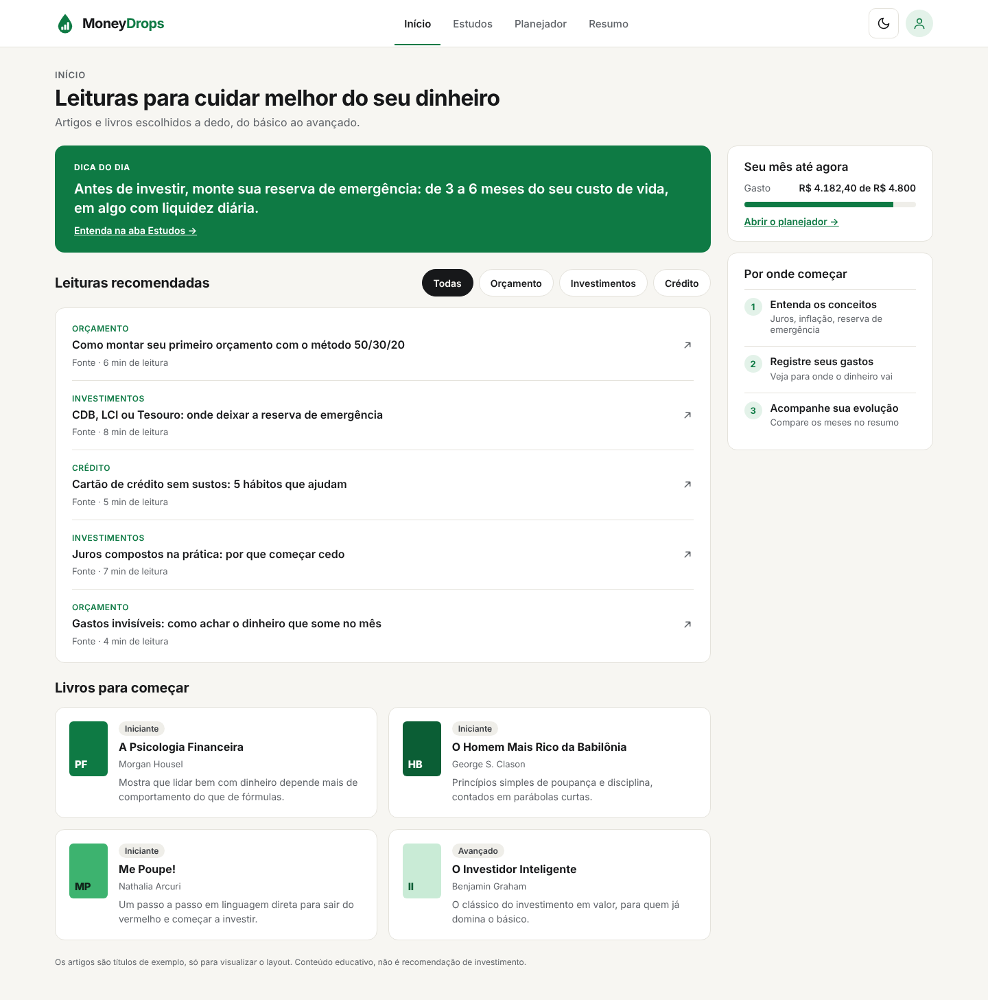
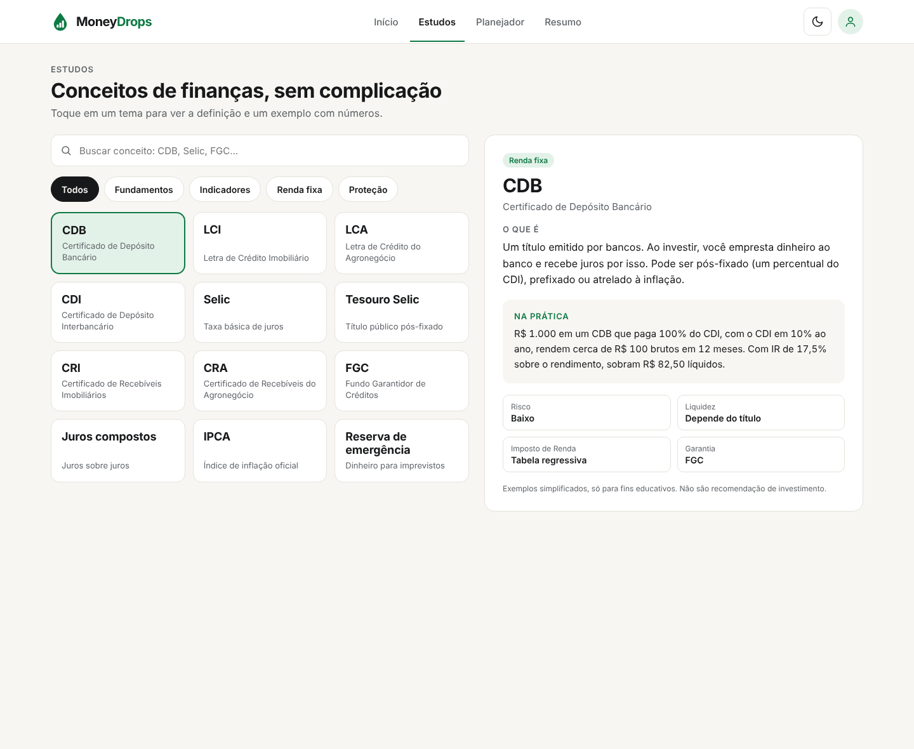
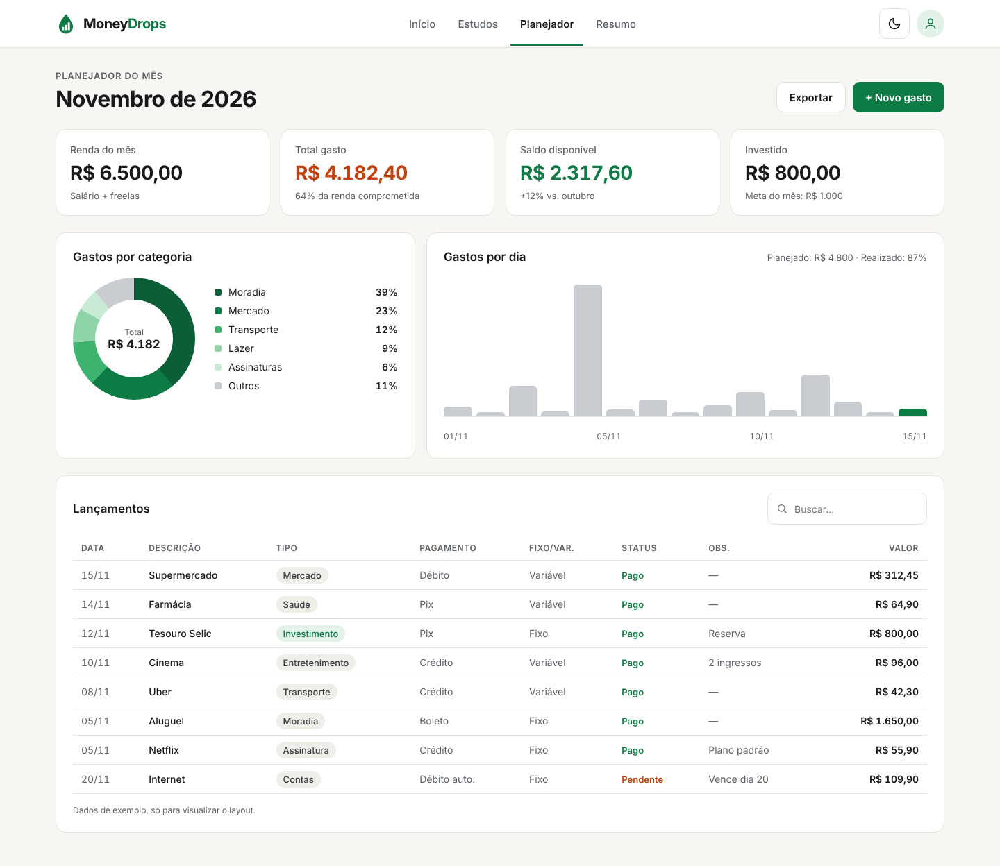
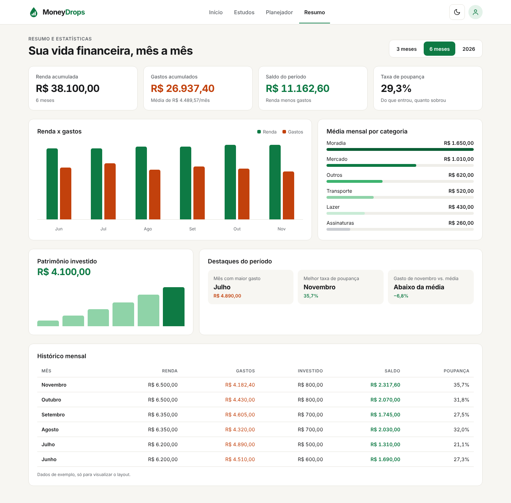
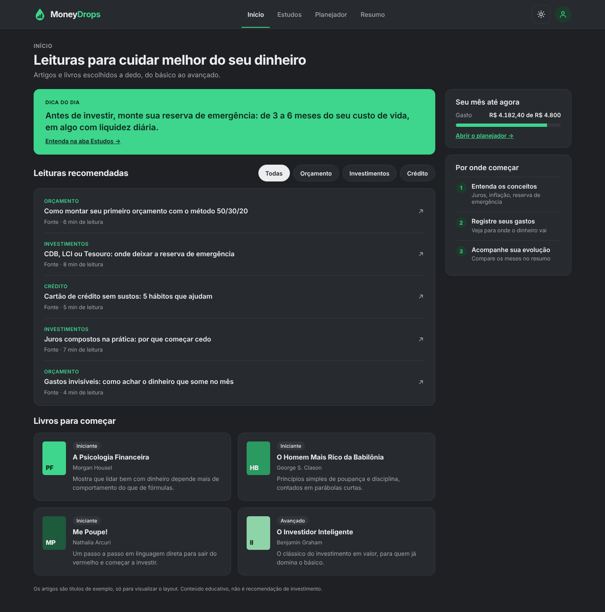
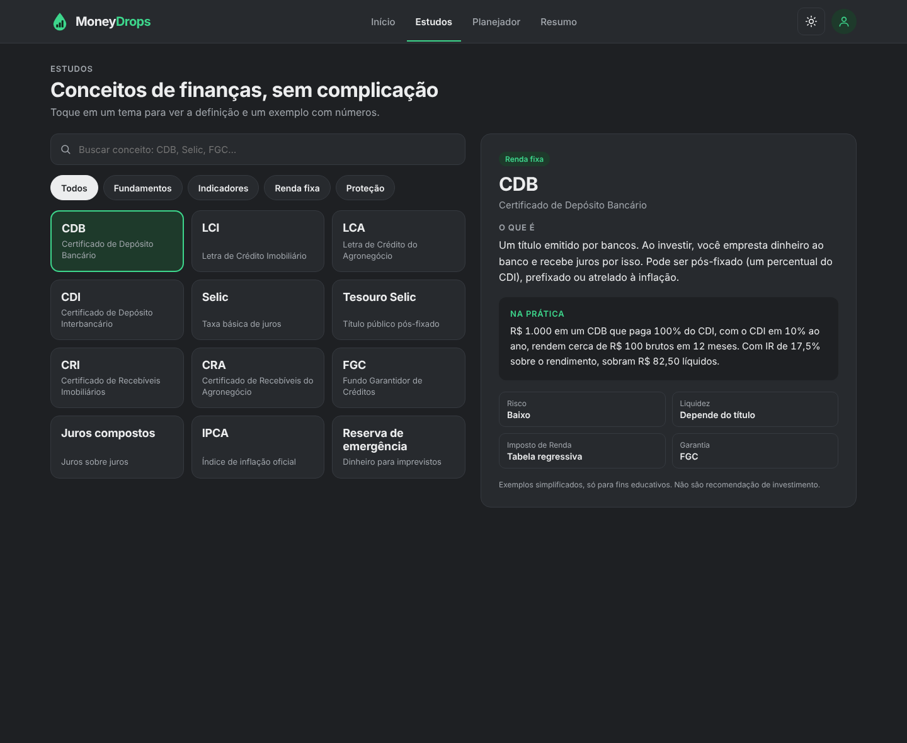
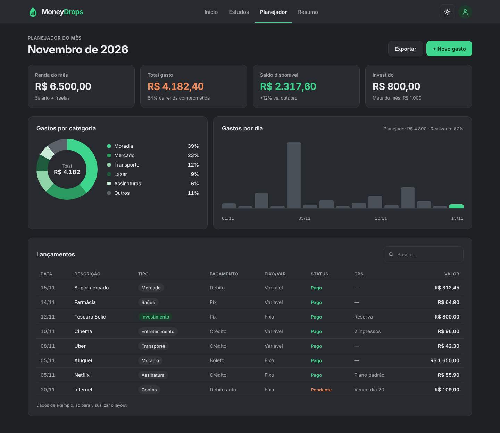
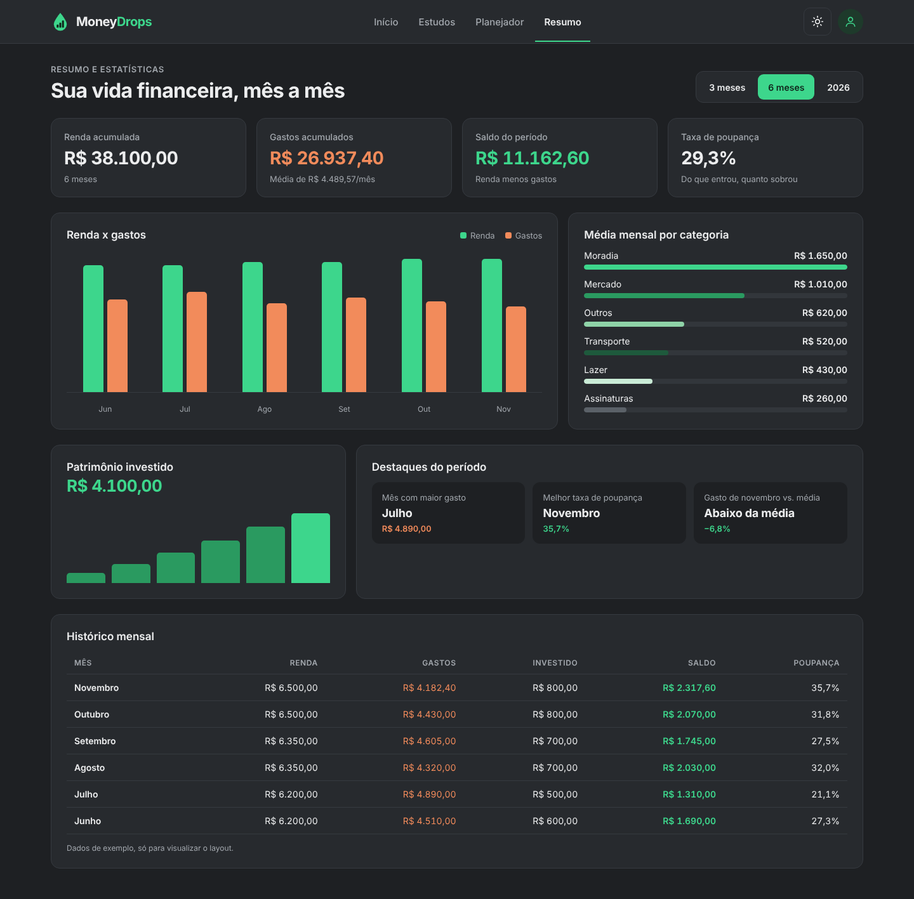

<p align="center">
  
</p>

# 💰 Planejador Financeiro Inteligente - MoneyDrops
 
> Um planejador financeiro pessoal na web, simples, objetivo e acessível. Descubra boas leituras, aprenda os conceitos que importam e controle seus gastos mês a mês, tudo em um só lugar.
 


 
---
 
## 📌 Sobre o projeto
 
O **Planejador Financeiro Pessoal** é uma aplicação web que reúne, em uma interface única, três necessidades de quem quer organizar a vida financeira:
 
1. **Leitura**: artigos e livros recomendados, escolhidos a dedo, e uma dica financeira por dia.
2. **Educação**: um glossário interativo com os principais conceitos de finanças pessoais e investimentos.
3. **Controle**: um planejador de gastos mensal com gráficos, além de um dashboard que consolida todo o histórico.
### 🎯 Visão de futuro
 
A ideia é que o projeto evolua para um **serviço por assinatura de baixo custo**: uma alternativa acessível às planilhas manuais e aos apps financeiros caros, com foco em clareza e simplicidade.

---

## 🖼️ Telas

Layouts das quatro abas com a [identidade visual](docs/identidade-visual.md) do MoneyDrops. Os valores são dados de exemplo.

| Início | Estudos |
|---|---|
|  |  |
| **Planejador do mês** | **Resumo e estatísticas** |
|  |  |

<details>
<summary><strong>🌙 Ver as telas no modo escuro</strong></summary>

| Início | Estudos |
|---|---|
|  |  |
| **Planejador do mês** | **Resumo e estatísticas** |
|  |  |

</details>

Mais detalhes de cada tela em [`docs/design`](docs/design/README.md). Para navegar entre elas no navegador, abra os arquivos de [`docs/design/prototipo`](docs/design/prototipo).
 
---
 
## 🧭 Funcionalidades
 
O app é organizado em **quatro abas**:
 
### 1. 🏠 Início: Leituras recomendadas

A página de entrada, com conteúdo selecionado para quem quer cuidar melhor do dinheiro.

- **Dica do dia**: uma dica prática de organização e economia, trocada a cada dia.
- **Leituras recomendadas**: artigos de finanças pessoais e investimentos, com tema, tempo de leitura e link para a fonte original.
- **Livros**: indicações do básico ao avançado, com o motivo para ler cada um.
- **Seu mês até agora**: um resumo do Planejador, com atalho para ele.
- **Por onde começar**: um caminho sugerido pelas outras abas.

O conteúdo é uma **curadoria própria**, guardada em arquivos do projeto. Não depende de APIs externas, não tem custo e mantém a qualidade e o idioma sob controle.

---
 
### 2. 📚 Estudos: Glossário Financeiro
 
Uma aba educativa com os conceitos essenciais apresentados em **botões/cards clicáveis**. Ao clicar em um tópico, abre-se:
 
- a **definição** do conceito, em linguagem simples;
- um **exemplo prático**, com números;
- (opcional) **vantagens, riscos e tributação**;
- (opcional) **links para conceitos relacionados**.
#### Tópicos previstos
 
| Categoria | Conceitos |
|---|---|
| **Fundamentos** | Juros simples, juros compostos, inflação, IPCA, IGP-M, poder de compra, reserva de emergência, liquidez, rentabilidade, risco x retorno |
| **Indicadores e taxas** | Selic, CDI, TR, IPCA+, taxa pré-fixada, taxa pós-fixada, rentabilidade real x nominal |
| **Renda fixa** | Poupança, CDB, LCI, LCA, LC, Tesouro Direto (Selic, Prefixado, IPCA+), CRI, CRA, debêntures, debêntures incentivadas |
| **Proteções e garantias** | FGC (Fundo Garantidor de Créditos), marcação a mercado, prazo de carência, vencimento |
| **Renda variável** | Ações, dividendos, JCP, ETFs, FIIs (fundos imobiliários), BDRs, índices (Ibovespa, IFIX, S&P 500) |
| **Fundos de investimento** | Fundos de renda fixa, multimercado, ações, taxa de administração, taxa de performance, come-cotas |
| **Tributação** | IR regressivo na renda fixa, isenções (LCI, LCA, CRI, CRA), IOF, IR sobre ações e FIIs, declaração |
| **Previdência** | Previdência privada, PGBL x VGBL, tabela progressiva x regressiva |
| **Crédito e dívidas** | CET (Custo Efetivo Total), rotativo do cartão, cheque especial, financiamento SAC x Price, score de crédito |
| **Planejamento** | Orçamento 50/30/20, perfil de investidor (suitability), diversificação, aportes recorrentes, metas financeiras |
 
> 💡 **Exemplo de card (CDB):**
> **CDB (Certificado de Depósito Bancário)** é um título que você "empresta" ao banco em troca de juros. Ele costuma render um percentual do CDI e é protegido pelo FGC até o limite estabelecido.
> *Exemplo:* R$ 1.000 aplicados em um CDB que paga 100% do CDI, com CDI de 10% ao ano, rendem cerca de R$ 100 brutos em 12 meses. Sobre o rendimento incide IR pela tabela regressiva.
 
---
 
### 3. 🗓️ Planejador do Mês: Controle Financeiro Mensal
 
Uma interface objetiva para registrar e acompanhar os gastos do **mês atual**.
 
#### a) Resumo estatístico (topo)
 
Cards com os principais números do mês:
 
- 💵 **Renda do mês**
- 💸 **Total gasto**
- 🟢 **Saldo disponível** (renda − gastos)
- 📈 **Total investido**
- 🏷️ **Categoria com maior gasto**
- 📊 **% da renda comprometida**
- 🎯 **Orçamento planejado x realizado**
#### b) Gráficos
 
- **Pizza/rosca**: distribuição dos gastos por categoria.
- **Barras**: planejado x realizado por categoria.
- **Linha**: evolução dos gastos ao longo dos dias do mês.
#### c) Planilha de gastos (abaixo)
 
Tabela editável com os lançamentos do mês:
 
| Coluna | Descrição | Exemplo |
|---|---|---|
| **Data** | Dia do gasto | 05/11/2026 |
| **Descrição** | Nome curto do gasto | Netflix |
| **Tipo/Categoria** | Classificação do gasto | Assinatura |
| **Valor (R$)** | Quanto foi gasto | 55,90 |
| **Forma de pagamento** | Como foi pago | Cartão de crédito |
| **Fixo/Variável** | Se o gasto se repete todo mês | Fixo |
| **Parcela** | Parcela atual / total (se houver) | 3/10 |
| **Status** | Pago ou pendente | Pago |
| **Essencial?** | Necessidade x desejo | Não |
| **Obs.** | Observações livres | Plano compartilhado |
 
**Categorias sugeridas:** Moradia, Mercado, Alimentação fora, Transporte, Saúde, Educação, Assinaturas, Entretenimento, Vestuário, Contas (água, luz, internet), Cuidados pessoais, Pets, Presentes, Dívidas, Investimento, Outros. *(Categorias personalizáveis pelo usuário.)*
 
**Recursos da planilha:**
- adicionar, editar e excluir lançamentos;
- filtrar e ordenar por coluna;
- busca por descrição;
- lançamentos recorrentes (gastos fixos copiados automaticamente para o mês seguinte);
- exportação para CSV/Excel.
---
 
### 4. 📊 Resumo e Estatísticas: Dashboard Consolidado
 
Um mini dashboard com **todo o histórico financeiro** do usuário, mês a mês.
 
- **Evolução mensal**: renda x gastos x investimentos ao longo do tempo.
- **Saldo acumulado** e evolução do patrimônio investido.
- **Gastos por categoria ao longo dos meses** (barras empilhadas).
- **Médias**: gasto médio mensal, média por categoria, taxa média de poupança.
- **Comparativos**: mês atual x mês anterior x média histórica.
- **Destaques**: maior gasto do período, categoria que mais cresceu, meses acima do orçamento.
- **Filtro de período**: últimos 3, 6 ou 12 meses, ano atual ou personalizado.
- **Histórico completo** de lançamentos com filtros.
---
 
## 🛠️ Stack (sugestão)
 
> A definir. Abaixo, uma sugestão de stack enxuta e escalável.
 
| Camada | Tecnologia |
|---|---|
| **Front-end** | React + TypeScript (Vite ou Next.js) |
| **Estilização** | Tailwind CSS |
| **Gráficos** | Recharts ou Chart.js |
| **Tabela** | TanStack Table |
| **Back-end / BaaS** | Supabase ou Firebase (autenticação + banco de dados) |
| **Banco de dados** | PostgreSQL |
| **Pagamentos (futuro)** | Stripe ou Mercado Pago |
| **Deploy** | Vercel / Netlify |
 
---
 
## 📚 Fontes de conteúdo

A primeira versão não usa APIs externas: as leituras, os livros, as dicas e o glossário são arquivos JSON do próprio projeto, atualizados manualmente.

APIs de notícias foram descartadas por enquanto. Os planos gratuitos das principais não permitem uso comercial, e os pagos seriam o maior custo fixo do app.

Para o futuro, se fizer sentido mostrar indicadores (Selic, CDI, IPCA, câmbio), há fontes públicas a avaliar, como a API SGS e a PTAX do Banco Central do Brasil.

---

## 🗂️ Estrutura de pastas

O código é organizado por funcionalidade: cada aba tem a sua pasta, e o que é comum fica em `shared`.

```
src/
├── features/
│   ├── inicio/        # Aba 1: leituras recomendadas
│   ├── estudos/       # Aba 2: glossário financeiro
│   ├── planejador/    # Aba 3: controle do mês atual
│   └── resumo/        # Aba 4: resumo e estatísticas
├── shared/
│   ├── components/    # Layout, cabeçalho, logo, botão de tema
│   ├── hooks/         # useTema
│   └── utils/         # Formatação de moeda (valores em centavos)
├── styles/            # tokens.css (identidade visual) e global.css
├── assets/brand/      # Logos
├── App.tsx            # Rotas
└── main.tsx           # Ponto de entrada
```
 
### Modelo de dados (rascunho)
 
```ts
type Gasto = {
  id: string;
  data: string;            // ISO date
  descricao: string;
  categoria: Categoria;
  valor: number;
  formaPagamento: 'dinheiro' | 'pix' | 'debito' | 'credito' | 'boleto';
  tipo: 'fixo' | 'variavel';
  parcela?: { atual: number; total: number };
  status: 'pago' | 'pendente';
  essencial: boolean;
  obs?: string;
};
 
type Mes = {
  ano: number;
  mes: number;             // 1 a 12
  renda: number;
  orcamentoPorCategoria: Record<Categoria, number>;
  gastos: Gasto[];
};
```
 
---
 
## 🚀 Como rodar localmente

Requer [Node.js](https://nodejs.org) 20.19 ou mais recente.

```bash
# Clonar o repositório
git clone https://github.com/gabriellfelipe7/desenv_moneydrops.git
cd desenv_moneydrops

# Instalar dependências
npm install

# Rodar em modo de desenvolvimento (http://localhost:5173)
npm run dev
```

| Comando | O que faz |
|---|---|
| `npm run dev` | Sobe o app local, com atualização automática |
| `npm run build` | Checa os tipos e gera a versão de produção em `dist/` |
| `npm run preview` | Serve a versão de produção localmente |
| `npm test` | Roda os testes |
| `npm run lint` | Analisa o código com o ESLint |
| `npm run format` | Formata o código com o Prettier |

O andamento do desenvolvimento está em [`docs/CHECKLIST.md`](docs/CHECKLIST.md).

---
 
## 🗺️ Roadmap
 
### MVP
- [x] Estrutura do projeto e navegação entre as quatro abas
- [ ] Aba Estudos com glossário estático (JSON)
- [ ] Aba Planejador com planilha e gráficos (dados salvos localmente)
- [ ] Aba Dashboard com consolidação dos meses
- [ ] Aba Início com leituras, livros e dica do dia (curadoria em JSON)
### Versão 1.0
- [ ] Cadastro e login de usuários
- [ ] Persistência em banco de dados na nuvem
- [ ] Gastos recorrentes e parcelados automáticos
- [ ] Orçamento por categoria com alertas
- [ ] Exportação para CSV/Excel
- [ ] Layout responsivo (mobile first)
- [ ] Modo escuro
### Futuro
- [ ] Plano por assinatura de baixo custo
- [ ] Metas financeiras (viagem, reserva de emergência, etc.)
- [ ] Simuladores (juros compostos, CDB x LCI, financiamento)
- [ ] Importação de extratos (OFX/CSV)
- [ ] Integração com Open Finance
- [ ] Notificações de contas a vencer
- [ ] App mobile (PWA)
---
 
## 🤝 Contribuindo
 
1. Faça um fork do projeto
2. Crie uma branch: `git checkout -b feature/minha-feature`
3. Faça commit das alterações: `git commit -m "feat: minha feature"`
4. Envie para o repositório: `git push origin feature/minha-feature`
5. Abra um Pull Request
---
 
## ⚖️ Aviso legal
 
O conteúdo deste aplicativo tem caráter **exclusivamente educativo e informativo** e **não constitui recomendação de investimento**. Antes de investir, avalie seu perfil e, se necessário, consulte um profissional certificado.
 
---
 
## 📄 Licença
 
A definir.
 
---
 
<p align="center">Feito com 💚 para quem quer cuidar melhor do próprio dinheiro.</p>
