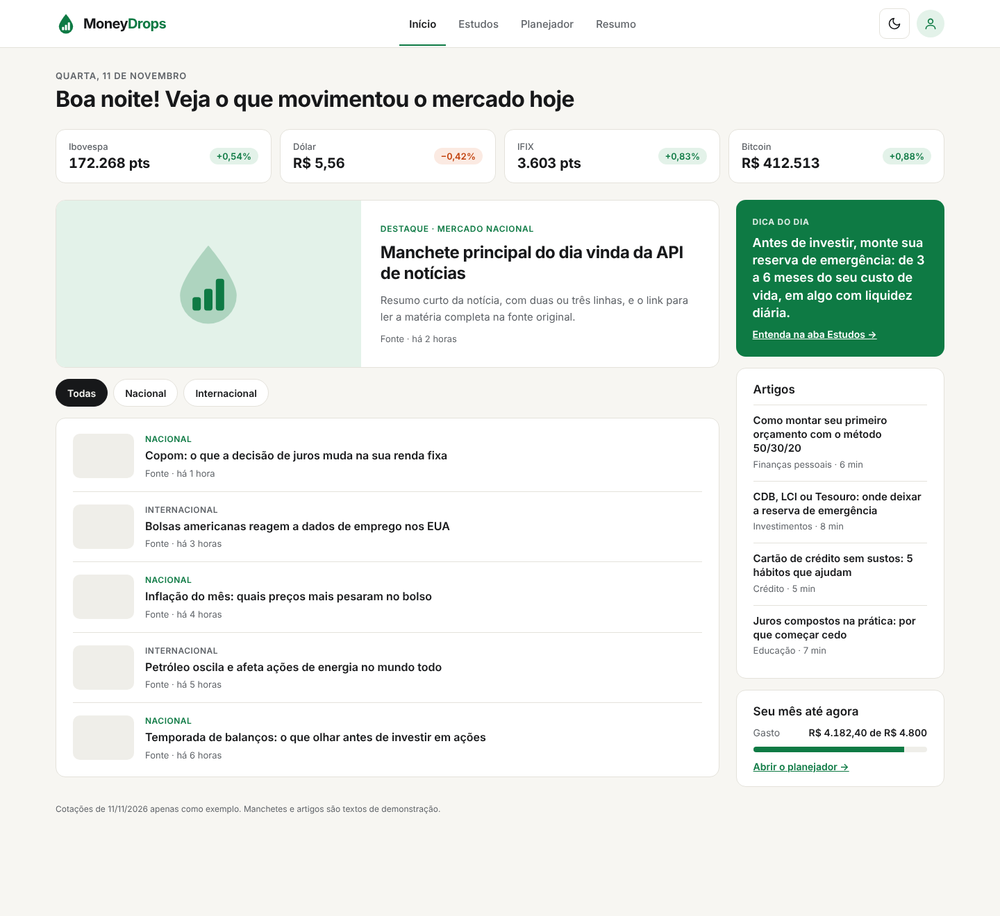
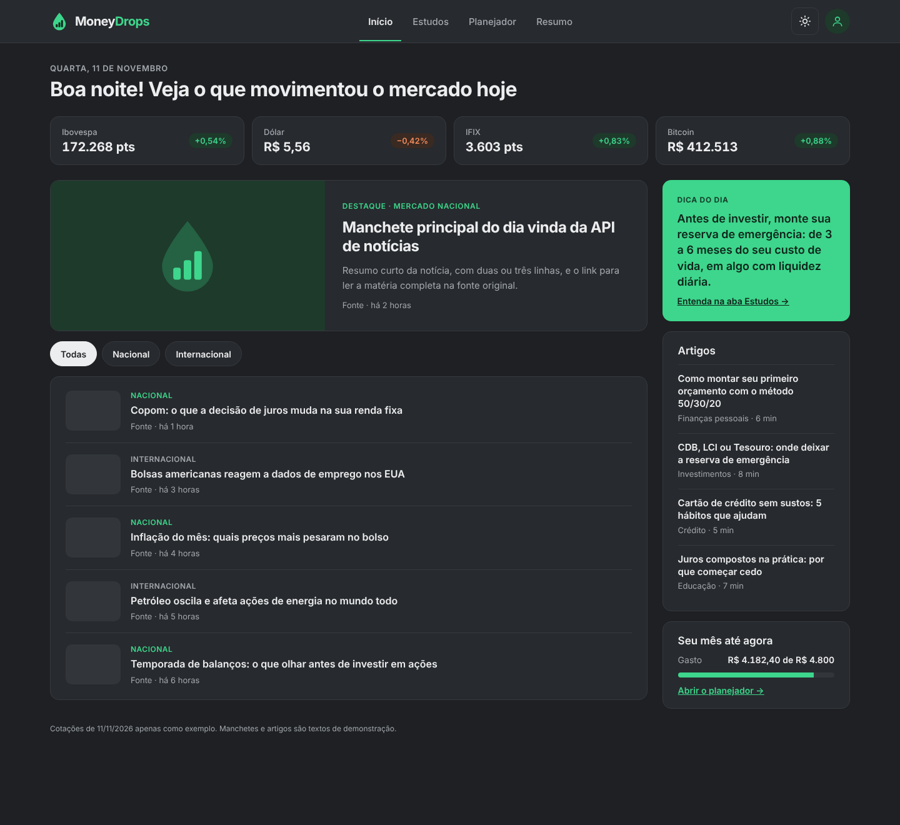
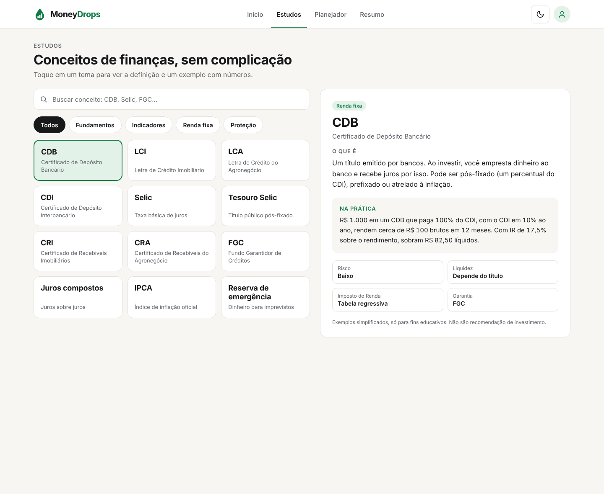
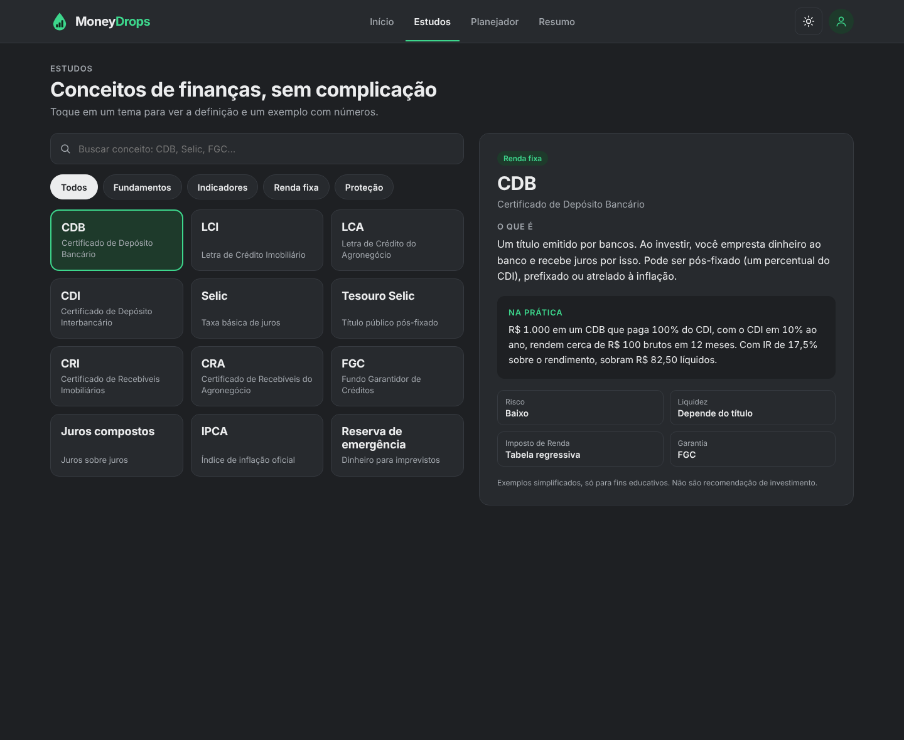
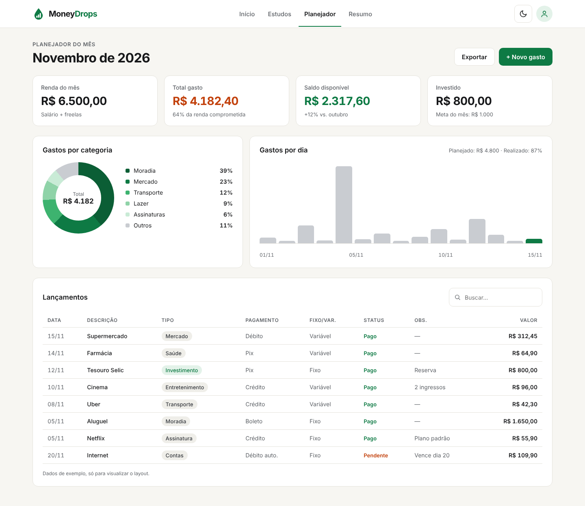
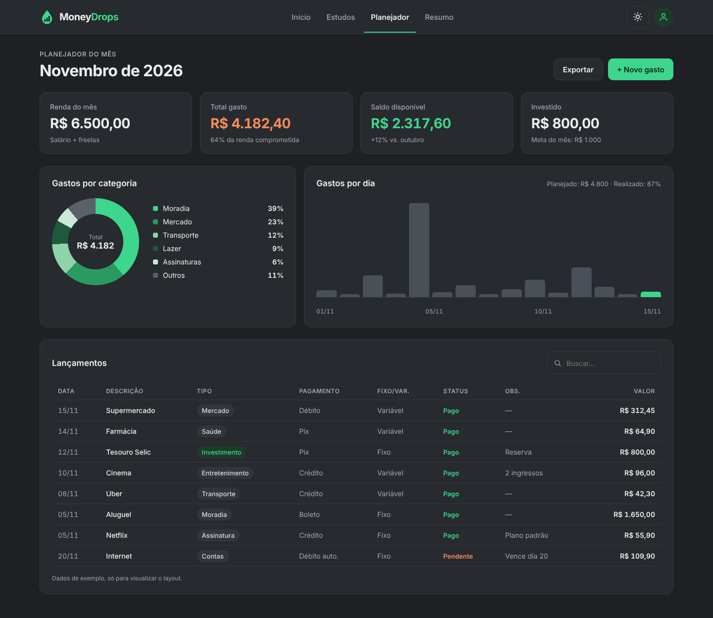
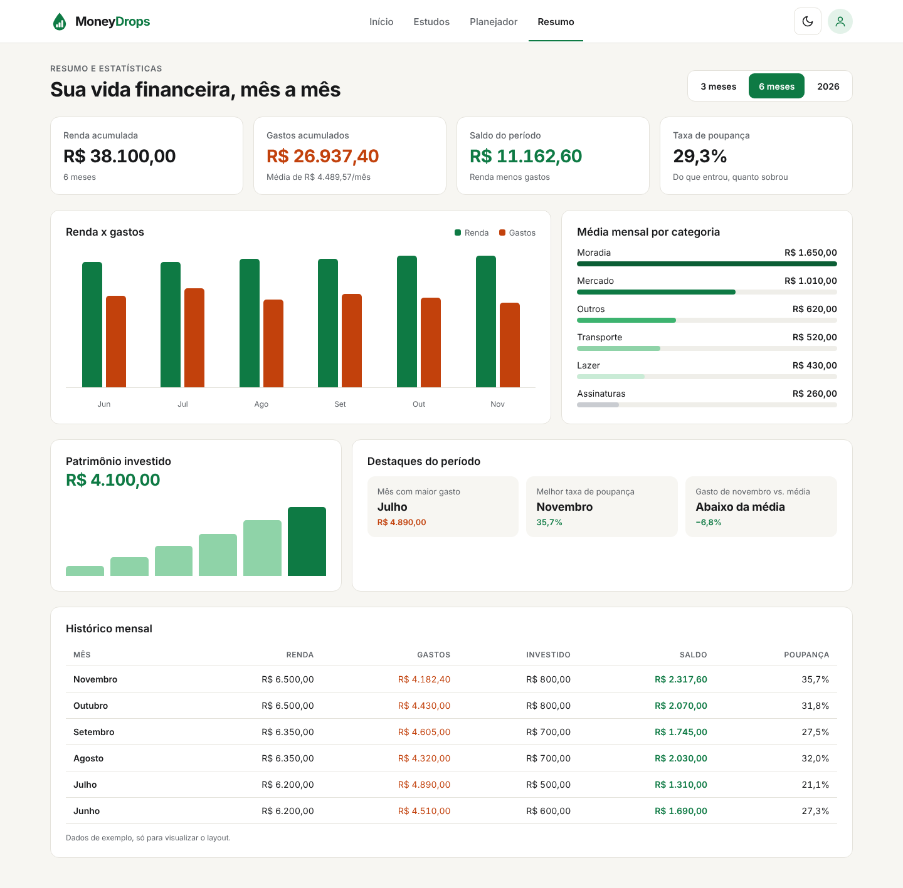
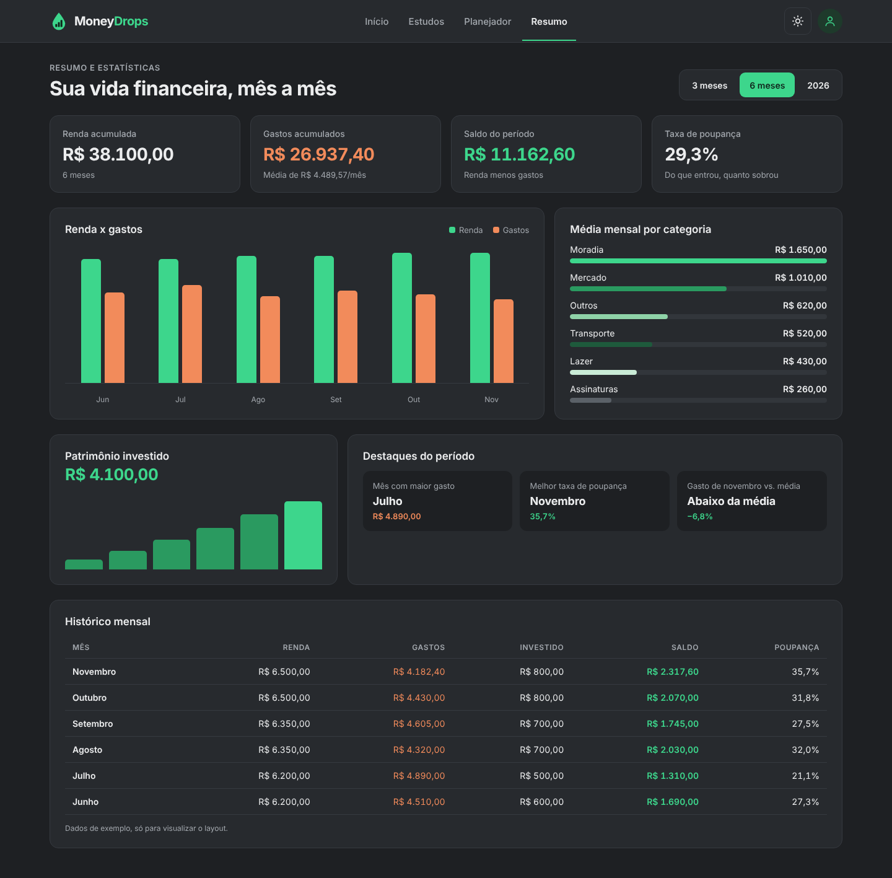

# Layouts das telas · MoneyDrops

Referência visual das quatro abas do app, usando a [identidade visual](../identidade-visual.md) (Inter, off-white/cinza e Verde Drop).

- **`screenshots/`** — imagens de cada tela nos modos claro e escuro.
- **`prototipo/`** — as mesmas telas em HTML estático. Abra qualquer arquivo no navegador; o menu do topo navega entre as abas.

> Os valores e manchetes são **dados de exemplo**, só para visualizar o layout. As definições da aba Estudos são conteúdo real e podem ir direto para o app.

## 1. Início

Cotações do dia, notícia em destaque, lista de notícias com filtro Nacional/Internacional, dica do dia, artigos e um resumo do mês.

| Claro | Escuro |
|---|---|
|  |  |

## 2. Estudos

Busca, filtro por categoria e conceitos em botões. Ao selecionar um, abre a definição, um exemplo com números e, nos investimentos, uma ficha com risco, liquidez, IR e garantia.

| Claro | Escuro |
|---|---|
|  |  |

## 3. Planejador do mês

Cards de resumo, gastos por categoria e por dia, e a planilha de lançamentos.

| Claro | Escuro |
|---|---|
|  |  |

## 4. Resumo e estatísticas

Filtro de período, totais acumulados, renda x gastos, média por categoria, patrimônio investido, destaques e histórico mensal.

| Claro | Escuro |
|---|---|
|  |  |
